<a href="https://talcloud.fr">
  <picture>
    <source media="(prefers-color-scheme: dark)" srcset="./assets/header-dark.svg">
    
  </picture>
</a>

  
  
  

## Bonjour, moi c'est Anthony 👋

Je dirige **[TalCloud](https://talcloud.fr)**, un hébergeur français indépendant né d'une passion simple : les jeux vidéo.

> *« Je ne vends pas du cloud. Je vends des machines que j'ai montées moi-même, et dont je connais chaque câble. »*

### Mon histoire

Tout a commencé par des parties entre amis, et par une question toute bête : *pourquoi ça lague ?*
Pour y répondre, j'ai ouvert des machines, comparé des composants, tiré des câbles et commencé à apprendre le réseau sur le tas. Très vite, héberger les serveurs de mes proches est devenu plus passionnant que d'y jouer.

J'en ai fait mon métier avec un **Bac Pro CIEL** (Cybersécurité, Informatique et réseaux, Électronique), qui a donné des bases solides à ce que je bricolais jusque-là par passion.

Pendant plus de cinq ans, on a fait tourner leurs mondes Minecraft, leurs villes FiveM et leurs bots Discord, en apprenant à chaque panne et à chaque pic de charge. En **2026**, cette passion est devenue une entreprise française : **TalCloud**.

Aujourd'hui, j'en porte la vision, et je garde les mains dans le **métal** : monter, configurer et optimiser les serveurs et le réseau qui font tourner vos projets. Ma conviction est simple : un bon hébergeur, c'est du matériel sérieux, des chiffres honnêtes et quelqu'un qui vous répond.

### Ce à quoi je tiens

- 🇫🇷 Une infrastructure **100 % hébergée en France**, à moins de 15 ms de Paris
- 🧱 **Aucune survente** : la ressource que vous payez est la vôtre
- 🛡️ Anti-DDoS **L3/L4/L7** inclus sur chaque offre
- 🎮 Joueur avant tout, avec un support francophone qui parle votre langue

## TalCloud en chiffres

<picture>
  <source media="(prefers-color-scheme: dark)" srcset="./assets/metrics-dark.svg">
  
</picture>

## Ce qu'on héberge

| | Offre | Pour quoi faire | À partir de |
|:-:|---|---|--:|
| ⛏️ | **Serveurs Minecraft** | Vanilla, moddé ou réseau, déployé en 60 secondes | **2,99 €** / mois |
| 🚓 | **Serveurs FiveM** | Votre ville RP, txAdmin et base MySQL préinstallés | **5,49 €** / mois |
| 🤖 | **Bots Discord** | Python ou Node.js, en ligne 24/7, logs en direct | **1,99 €** / mois |
| 🐧 | **VPS Cloud** | Accès root complet, snapshots, Linux au choix | **4,99 €** / mois |
| 🌐 | **Hébergement web** | SSL, PHP 8.x, MySQL, sauvegardes automatiques | *Bientôt* |

## Sous le capot

  
  
  
  
  
  
  
  

## Me contacter

Un projet à héberger, une question sur l'infra, une idée de partenariat ?
Le plus rapide reste le **[Discord TalCloud](https://discord.gg/GuU42pPC68)**, sinon tout est sur **[talcloud.fr](https://talcloud.fr)**.

Tal_Cloud_ · Paris, édition 2026 · L'hébergement français qui voit grand.

